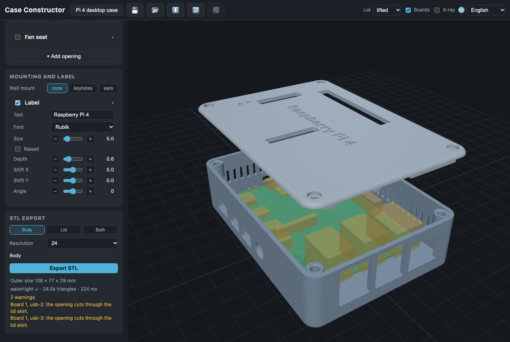
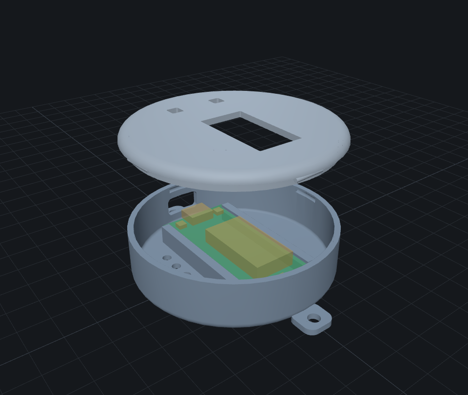
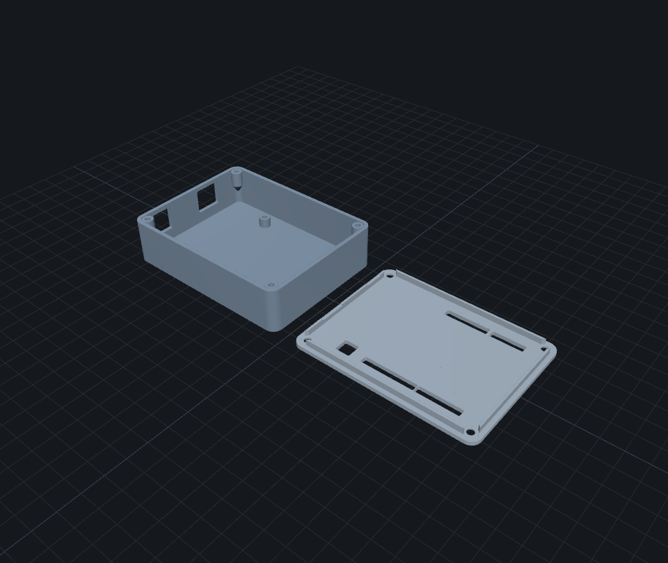

# Case Constructor

A web app that builds a 3D-printable enclosure for a PCB and exports STL:
pick a case shape, size it, choose where the lid goes and how it holds — the
app splits the shell, adds the lid skirt and lays both parts out for
printing.

**Live:** https://dmitryweiner.github.io/case-constructor/



| | |
|---|---|
|  |  |

## Features

- Box with rounded corners and edge fillets, cylinder, console with a sloped
  top, sized automatically around the boards.
- A catalog of 35 boards — Raspberry Pi, Banana Pi, Orange Pi, Radxa, Repka
  Pi, Walnut Pi, Espressif ESP32, Arduino, Heltec — or your own board, on
  standoffs with tap, heat-set insert or nut holes, or held by grooved rails.
- Openings for every connector, your own cutouts, ventilation, a fan seat.
- A lid on any face (the cylinder: top or bottom; the console: any face but
  the slope), flat or taking part of the walls, with a skirt and a printing
  clearance, on snaps, screws, magnets or printed screws (thumb screws in the
  lid's STL, a matching thread in the posts); wall mounting (ears, through or
  closed keyholes); a label on the lid.
- Exact preview: the same CSG pipeline as the export, in a web worker; the
  boards drawn schematically inside, the case exploded, assembled or laid out
  for printing, with a caption saying what is shown.
- Several boards arranged in a row, a column or compact, or aligned to each
  other.
- STL export of the body, the lid (with its printed screws), or both in one
  file, already oriented for printing.
- Built-in presets, your own presets in the browser, project files (JSON),
  undo/redo.
- English, Russian, Ukrainian, Hebrew.

User documentation: [docs/](docs/README.md).

## Development

```bash
npm install
npm run dev       # http://localhost:5173
npm run check     # tsc + eslint + vitest
npm run smoke     # browser smoke (Playwright)
npm run build
```

Stack: Vite, TypeScript, Three.js, [manifold-3d](https://github.com/elalish/manifold)
(WASM, in a worker), vitest, Playwright. A sibling of
[ClayForm](https://github.com/dmitryweiner/clayform).

## License

GPL-3.0, see [LICENSE](LICENSE).
